# Лабораторная работа №6. Система контроля версий

**Цель лабораторной работы:** изучение базовых возможностей системы управления версиями, опыт работы с Git Api, опыт работы с локальным и удаленным репозиторием.

## Лог команд
```bash
# Проверка версии и настройка Git
git --version
git config --global user.name "4517 Рзаев М.Р."
git config --global user.email "rzaevmr@list.ru"
git config --global --list
# Клонирование репозитория
git clone https://github.com/Gruneh/LR6.git
cd LR6
git pull
# Просмотр истории и веток
git branch -a
git log --oneline --graph --all
git log -p -1
# Создание побочной ветки и коммит
git checkout -b feature-conflict
git add .
git commit -m "изменение в feature-ветке"
# Переключение на master и коммит
git checkout master
git commit -am "изменение в master"
# Слияние веток и разрешение конфликта
git merge feature-conflict
git add .
git commit -m "разрешение конфликта слияния"
# Удаление побочной ветки
git branch -d feature-conflict
# Несколько коммитов подряд
git commit -am "комментарий 1"
git commit -am "комментарий 2"
# Откат коммита
git log --oneline
git revert HEAD
# Создание ветки для отчета
git checkout -b report
```

## Ход работы
### 1. Создание форка и настройка Git
Была выполнена настройка клиента git (имя пользователя и email), а также создан форк репозитория на GitHub.
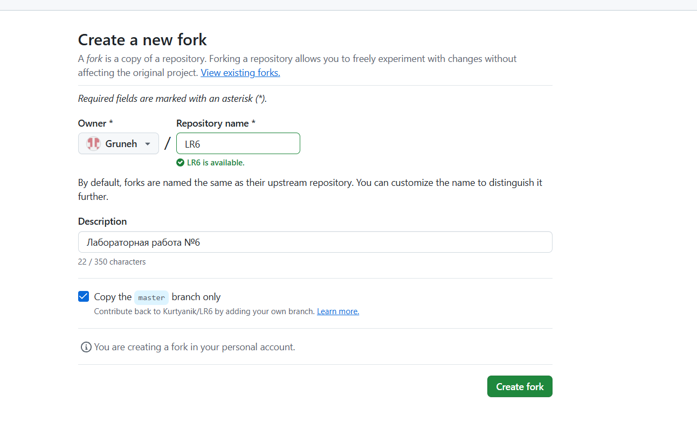
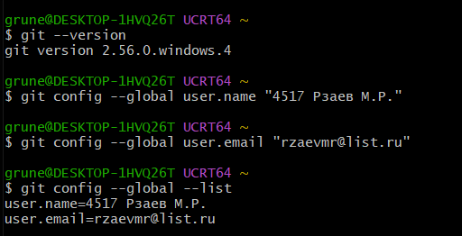

### 2. Клонирование репозитория и синхронизация
Удаленный репозиторий был склонирован на компьютер. Затем был добавлен файл через веб-интерфейс GitHub и подтянуты изменения локально.
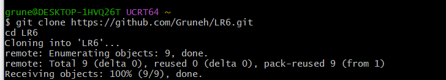
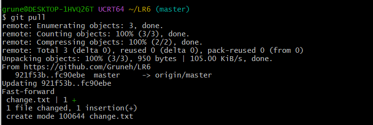

### 3. Просмотр истории и изменений
Получена история операций для всех веток, а также просмотрены последние изменения.
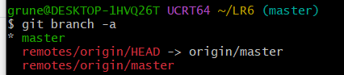
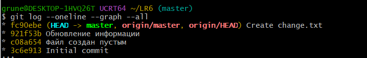
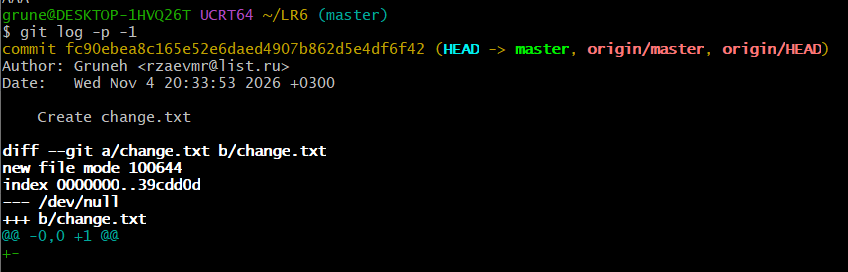

### 4. Слияние веток и разрешение конфликта
Была создана побочная ветка, в ней изменен файл. После переключения в master и изменения того же файла, при слиянии возник конфликт. Конфликт был разрешен вручную.
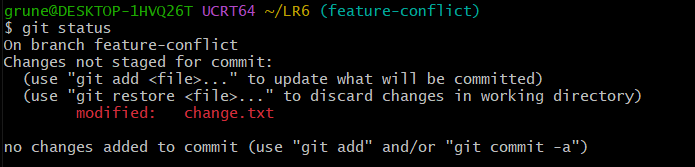
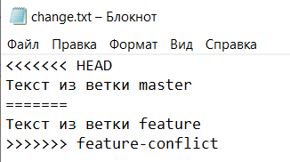
После разрешения конфликта изменения были зафиксированы, а побочная ветка удалена.

### 5. Фиксация изменений и откат коммита
Было сделано несколько коммитов. Затем выполнен откат последнего коммита с помощью команды git revert.
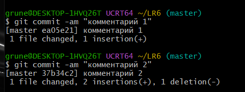
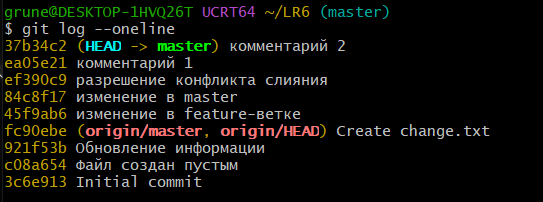
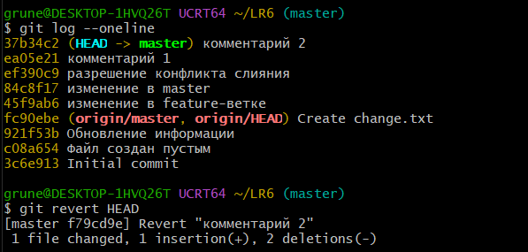

### 6. Создание ветки для отчета
Для оформления отчета была создана отдельная ветка report.
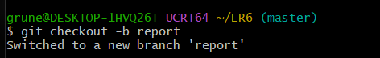

# История операций
```bash
$ git log --pretty=format:"%h - %ad - %an - %s" --date=short
f79cd9e - 2026-11-04 - 4517 Рзаев М.Р. - Revert "комментарий 2"
37b34c2 - 2026-11-04 - 4517 Рзаев М.Р. - комментарий 2
ea05e21 - 2026-11-04 - 4517 Рзаев М.Р. - комментарий 1
ef390c9 - 2026-11-04 - 4517 Рзаев М.Р. - разрешение конфликта слияния
84c8f17 - 2026-11-04 - 4517 Рзаев М.Р. - изменение в master
45f9ab6 - 2026-11-04 - 4517 Рзаев М.Р. - изменение в feature-ветке
fc90ebe - 2026-11-04 - Gruneh - Create change.txt
921f53b - 2020-11-21 - Kurtyanik - Обновление информации
c08a654 - 2020-11-21 - Kurtyanik - Файл создан пустым
3c6e913 - 2020-11-21 - Kurtyanik - Initial commit
```
